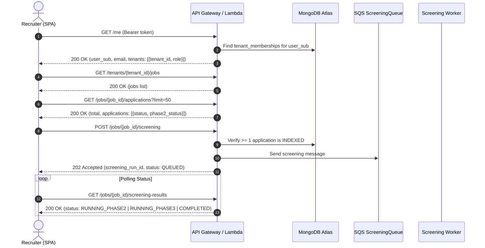
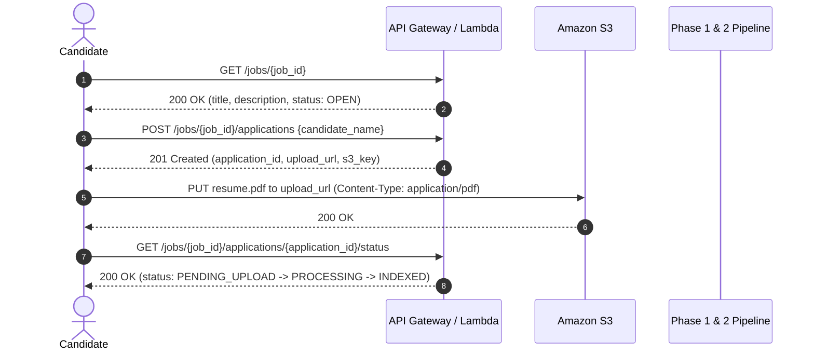

# API Contract & Frontend Integration Guide

## 1. Overview & Architecture

The AI Resume Screening SaaS backend provides a multi-tenant REST API designed for two distinct user workflows:

1. **Recruiter Workspace (Protected):** Requires an Amazon Cognito JWT (`Authorization: Bearer <token>`). Every request strictly verifies tenant membership and role permissions (`ADMIN` vs `MEMBER`) against trusted MongoDB records.
2. **Candidate Application Portal (Public):** Does **not** require authentication. Candidates view published job details, submit applications, obtain presigned S3 URLs, and check processing status without access to recruiter functions, tenant identifiers, screening scores, or other applicants.

---

## 2. Authentication & Authorization Model

### Headers
- **Protected routes:** `Authorization: Bearer <id_token_or_access_token>`
- **Content type:** `Content-Type: application/json`

### Roles & Access Matrix

| Role | Permissions |
|---|---|
| **ADMIN** | Full administrative control within the tenant: create jobs, update jobs, trigger screening runs, invite/manage tenant members. |
| **MEMBER** | Read-only access within the tenant: list jobs, view job details, list applications, view application details, view screening results. |
| **Public** | Candidate actions: view public job posting, submit application & get presigned upload URL, check own application status. |

---

## 3. Endpoints Inventory

### Recruiter Workspace (Protected)

| Method | Path | Required Role | Description |
|---|---|---|---|
| `GET` | `/me` | Any Authenticated | Returns caller identity (`user_sub`, `email`) and tenant memberships with roles. |
| `POST` | `/tenants` | Any Authenticated | Creates a new tenant organization and assigns caller as `ADMIN`. |
| `POST` | `/tenants/{tenant_id}/jobs` | `ADMIN` | Creates a new job posting under the tenant. |
| `GET` | `/tenants/{tenant_id}/jobs` | `MEMBER` | Lists all jobs for the tenant. |
| `GET` | `/tenants/{tenant_id}/jobs/{job_id}` | `MEMBER` | Recruiter detail view of a job including application counts. |
| `PATCH` | `/jobs/{job_id}` | `ADMIN` | Updates job `title`, `description`, or `status` (`OPEN` / `CLOSED` / `ARCHIVED`). |
| `DELETE` | `/jobs/{job_id}` | `ADMIN` | Safely archives a job (`status: "ARCHIVED"`), preventing new applications while preserving audit history. |
| `GET` | `/jobs/{job_id}/applications` | `MEMBER` | Lists applications for a job with pagination (`limit`, `skip`, `status`). |
| `GET` | `/jobs/{job_id}/applications/{application_id}` | `MEMBER` | Recruiter detail view of applicant and resume version history. |
| `DELETE` | `/jobs/{job_id}/applications/{application_id}` | `MEMBER` | Safely archives an application (`status: "ARCHIVED"`). |
| `POST` | `/jobs/{job_id}/screening` | `ADMIN` | Triggers Phase 2+3+4 screening for all indexed applications. |
| `GET` | `/jobs/{job_id}/screening-results` | `MEMBER` | Gets latest screening results with rankings and Phase 4 explanations. |
| `GET` | `/screening-runs/{screening_run_id}` | `MEMBER` | Gets specific screening run by ID with tenant isolation verification. |
| `GET` | `/tenants/{tenant_id}/members` | `MEMBER` | Lists all team members belonging to the tenant. |
| `POST` | `/tenants/{tenant_id}/members` | `ADMIN` | Adds or updates a team member (`user_sub`, `role: "ADMIN" | "MEMBER"`). |
| `DELETE` | `/tenants/{tenant_id}/members/{user_sub}` | `ADMIN` | Revokes organization membership for a user (with sole admin protection). |

### Candidate Application Portal (Public)

| Method | Path | Auth | Description |
|---|---|---|---|
| `GET` | `/jobs/{job_id}` | Public | Public job description for candidate application portal. Strips tenant data. |
| `POST` | `/jobs/{job_id}/applications` | Public | Submits application and returns S3 presigned PUT URL for resume PDF. |
| `GET` | `/jobs/{job_id}/applications/{application_id}/status` | Public | Candidate checks upload & indexing status using private `application_id`. |

---

### Resource Lifecycle & Deletion Policy

1. **Jobs (Archival over Hard Deletion):**
   - Hard deleting a job drops relational integrity with candidate resumes stored in S3, MongoDB vector chunks, and historical screening runs.
   - Therefore, `DELETE /jobs/{job_id}` performs a **soft-delete / archival**: it transitions the job status to `ARCHIVED`.
   - Archived jobs are no longer displayed on public job boards and cannot receive new applications, but remain accessible to recruiters for compliance.
2. **Applications (Archival):**
   - Recruiters can archive withdrawn or disqualified candidates via `DELETE /jobs/{job_id}/applications/{application_id}`.
   - The application status transitions to `ARCHIVED`, excluding it from subsequent screening runs while preserving audit logs.
3. **Tenant Memberships (Revocation):**
   - Admins can revoke access via `DELETE /tenants/{tenant_id}/members/{user_sub}`.
   - **Sole Administrator Protection:** If the target user is the only `ADMIN` in the tenant, the backend rejects revocation with HTTP `400 Bad Request` (`LAST_ADMIN_PROTECTION`) to prevent permanently orphaned tenant organizations.

---

## 4. Frontend Integration Workflows

### Recruiter Workflow: Login to Screening Results



### Candidate Workflow: Public Application Submission



---

## 5. Screening Results Response Schema (with Phase 4 Explainability)

When `GET /jobs/{job_id}/screening-results` or `GET /screening-runs/{screening_run_id}` is called:

```json
{
  "screening_run_id": "8f3b2e7a-1122-43bb-a55e-9a1b2c3d4e5f",
  "job_id": "backend-eng-001",
  "tenant_id": "tenant-alpha",
  "status": "COMPLETED",
  "phase2_status": "COMPLETED",
  "phase3_status": "COMPLETED",
  "phase4_status": "COMPLETED",
  "eligible_candidate_count": 5,
  "candidate_count": 5,
  "processing_time_sec": 3.82,
  "created_at": "2026-10-13T12:00:00Z",
  "completed_at": "2026-10-13T12:00:04Z",
  "candidates": [
    {
      "candidate_id": "cand_alice",
      "application_id": "app_alice_01",
      "candidate_name": "Alice Smith",
      "rerank_rank": 1,
      "rerank_score": 0.94215,
      "rank_change": 0,
      "phase2": {
        "hybrid_score": 0.0823,
        "lexical_rank": 1,
        "vector_rank": 1,
        "matched_chunks": [
          { "chunk_id": "alice_exp_00", "section": "experience" },
          { "chunk_id": "alice_skills_00", "section": "skills" }
        ]
      },
      "source_key": "tenants/tenant-alpha/jobs/backend-eng-001/applications/app_alice_01/resume.pdf",
      "explanation": {
        "candidate_id": "cand_alice",
        "rerank_rank": 1,
        "rerank_score": 0.94215,
        "summary": "Ranked #1 by semantic reranking. The retrieved resume evidence includes relevant experience and skills aligned with the job requirements, with supporting content found in the Experience, Skills section(s).",
        "matched_sections": ["experience", "skills"],
        "supporting_evidence": [
          {
            "chunk_id": "alice_exp_00",
            "section": "experience",
            "excerpt": "Senior Python developer building high-throughput APIs with PostgreSQL and Redis caching.",
            "relevance_keyword": "Python",
            "content_hash": "a4d8721c4e97652e"
          }
        ],
        "requirement_alignment": [
          {
            "requirement": "3+ years of Python backend development",
            "category": "required",
            "status": "supported",
            "supporting_chunks": ["alice_exp_00"],
            "evidence_excerpts": [
              "Senior Python developer building high-throughput APIs with PostgreSQL and Redis caching."
            ],
            "rationale": "Supported by candidate's resume content with relevant evidence for (Python) in chunk(s) alice_exp_00."
          },
          {
            "requirement": "Kafka event-driven streaming",
            "category": "preferred",
            "status": "not_established",
            "supporting_chunks": [],
            "evidence_excerpts": [],
            "rationale": "Direct evidence for this requirement was not established in the candidate's retrieved resume chunks."
          }
        ],
        "evidence_gaps": [
          "Requirement 'Kafka event-driven streaming' was not established by the retrieved resume evidence (indicates absence of evidence in retrieved chunks, not necessarily absence of qualification)."
        ],
        "limitations": [
          "Explanations reflect only the resume chunks retrieved and evaluated in Phases 2 and 3, not the full un-chunked resume or full candidate background.",
          "Reranker rank reflects overall semantic relevance to the job description, not an isolated sum or arithmetic score of individual requirements.",
          "Unestablished requirements indicate absence of direct evidence in retrieved resume chunks, not confirmed lack of candidate qualification.",
          "No protected personal characteristics (e.g. age, gender, ethnicity) are evaluated or utilized in ranking or explainability."
        ],
        "explanation_version": "1.0.0"
      }
    }
  ]
}
```

---

## 6. Lifecycle & Error States for Frontend Display

| Entity | State | Frontend Badge / Action |
|---|---|---|
| **Application** | `PENDING_UPLOAD` | Yellow: "Upload Pending" (waiting for PDF PUT to S3) |
| **Application** | `PROCESSING` / `phase1_status: "IN_PROGRESS"` | Blue spinner: "Text Extraction" (Textract async) |
| **Application** | `phase2_status: "INDEXING"` | Blue spinner: "Embedding & Indexing" |
| **Application** | `phase2_status: "INDEXED"` | Green check: "Ready for Screening" |
| **Application** | `FAILED` | Red alert: "Processing Failed" |
| **Screening Run** | `QUEUED` | Yellow: "Queued" |
| **Screening Run** | `RUNNING_PHASE2` | Blue spinner: "Hybrid Retrieval" |
| **Screening Run** | `RUNNING_PHASE3` | Blue spinner: "Semantic Reranking" |
| **Screening Run** | `COMPLETED` | Green check: Display Ranked Candidates & Evidence |
| **Screening Run** | `FAILED` | Red alert: Display error message |
